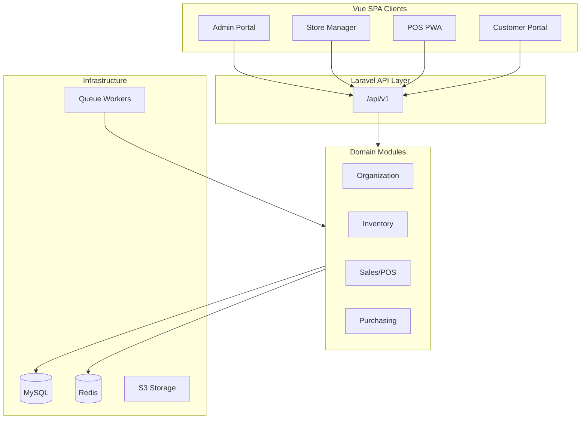

# Architecture Spine — retail-soln

## Design Paradigm

**Modular monolith with hexagonal domain services.**

Laravel nWidart modules define domain boundaries. Each module exposes:
- **Domain layer:** entities, value objects, domain services (pure business logic)
- **Application layer:** use cases / actions orchestrating domain services
- **Infrastructure layer:** Eloquent repositories, external adapters
- **Interface layer:** HTTP controllers, API resources, event listeners

Vue 3 SPAs (admin, store manager, POS, customer portal) are **ports** consuming the REST API — no server-rendered Inertia views.



## Invariants & Rules

### AD-1 — API-first, no Inertia

- **Binds:** all frontend surfaces
- **Prevents:** mixed SSR/SPA patterns, duplicated business logic in Blade/Inertia
- **Rule:** All UIs are Vue 3 SPAs consuming `/api/v1`. Laravel serves API + minimal auth pages only. `[ADOPTED]` per proposal line 77.

### AD-2 — Inventory ledger as sole mutation path

- **Binds:** Inventory, Sales, Purchasing, Returns modules
- **Prevents:** silent stock drift from direct quantity updates
- **Rule:** Every stock change creates an `inventory_movement` record. Balances are derived/materialized from movements. Direct `$model->quantity -= n; save()` prohibited in application code.

### AD-3 — Atomic financial transactions

- **Binds:** Sales, Payments, Returns, Purchasing
- **Prevents:** partial sales leaving inconsistent inventory/payment/invoice state
- **Rule:** Sale completion runs in a single DB transaction: sale items → inventory validation → movements → payment → invoice stub → audit. Rollback on any failure. Money stored as DECIMAL, never float.

### AD-4 — Store-scoped authorization

- **Binds:** all store-scoped modules
- **Prevents:** cross-store data leakage
- **Rule:** Every store-scoped query applies organization + store scope via global scope or explicit policy check. Authorization enforced server-side via Policies; client checks are UX-only.

### AD-5 — Offline sync idempotency

- **Binds:** POS, Sync API (Phase 6)
- **Prevents:** duplicate sales on network retry
- **Rule:** Every offline transaction carries client UUID used as idempotency key. Server returns same result on duplicate push without re-processing. Server re-validates price, tax, auth, inventory — server is authoritative.

### AD-6 — Domain logic in services, not controllers

- **Binds:** all modules
- **Prevents:** untestable fat controllers, logic duplication across API and future CLI
- **Rule:** Controllers delegate to application actions/services. Pricing, promotions, tax, inventory, and sync logic live in named domain services.

### AD-7 — Event-driven side effects only

- **Binds:** Notifications, Reporting, Audit
- **Prevents:** consistency failures from async side effects in critical path
- **Rule:** Email, SMS, PDF generation, and reports dispatched via queued events AFTER transaction commit. Critical path never depends on async completion.

### AD-8 — Modular monolith boundaries

- **Binds:** module structure
- **Prevents:** 40+ micro-modules or god-module anti-pattern
- **Rule:** Group related domains into ~15–20 modules per proposal §2. Modules communicate via application services and domain events, not direct cross-module model access where avoidable.

### AD-9 — Offline oversell with manager approval `[ADOPTED]`

- **Binds:** Sync, Inventory, Sales (Phase 6)
- **Prevents:** silent rejection of valid offline sales vs uncontrolled negative stock
- **Rule:** When sync would drive available qty below zero, accept the sale, record ledger movement (may go negative), and create a **manager-approval exception**. Hard-reject is forbidden for this path.

### AD-10 — Payment provider abstraction `[ADOPTED]`

- **Binds:** Payments module
- **Prevents:** POS hard-coding a single gateway
- **Rule:** PaymentService supports **manual**, **Stripe**, and **Paystack** in MVP. Provider-specific logic behind adapters; webhooks idempotent.

### AD-11 — Loyalty rules engine `[ADOPTED]`

- **Binds:** Customers, Sales, Pricing
- **Prevents:** loyalty as a dead customer field
- **Rule:** v1 includes a loyalty rules engine (earn/redeem/eligibility). Gift cards remain deferred (OQ-1).

### AD-12 — Full accounting ledger `[ADOPTED]`

- **Binds:** Accounting module
- **Prevents:** reporting-only stubs mistaken for books of record
- **Rule:** Accounting is a full double-entry ledger, not CSV export alone. Delivery may trail POS MVP; schema and posting hooks designed early.

### AD-13 — ESC/POS receipt printing `[ADOPTED]`

- **Binds:** POS client
- **Prevents:** printer-specific UI coupling
- **Rule:** Receipt hardware abstraction targets **ESC/POS**. UI talks to a printer service port, not raw device APIs.

### AD-14 — Installment plans as first-class AR `[ADOPTED]`

- **Binds:** Sales, Payments, Customers, Accounting
- **Prevents:** informal “partial pay” balances with no schedule, or conflating split checkout with installments
- **Rule:** Time-separated balances use an **Installment Plan** aggregate (schedule lines + outstanding). Split payment = same-checkout multi-tender only. Default inventory mode: post sale movements when sale completes (pay-over-time). Layaway (reserve until paid) is optional org policy. New plans require registered customer; offline plan creation blocked unless Sync epic extends AD-5.

### AD-15 — Proforma invoices are non-fiscal until converted `[ADOPTED]`

- **Binds:** Sales, Invoices, Customers
- **Prevents:** treating quotes as tax invoices; inventory/AR side effects from drafts; number-series collisions
- **Rule:** **Proforma Invoice** is a separate document type from **Tax Invoice**. Proformas never post inventory, AR, or accounting journals. They use a dedicated number series and must display proforma labeling on UI/PDF. Conversion to Sale and/or Issued Tax Invoice is explicit (FR-30). Tax Invoice may still have its own `draft` status — that is not a proforma.

## Consistency Conventions

| Concern | Convention |
| --- | --- |
| Naming (entities) | Singular PascalCase models; snake_case tables/columns |
| Naming (API) | kebab-case URLs; camelCase JSON response fields |
| IDs | UUID for client-generated/offline entities; bigint PK for server entities |
| Dates | UTC storage; ISO 8601 in API |
| Errors | `{ "message": "...", "errors": { "field": ["..."] } }` shape |
| Auth | Sanctum bearer tokens; Fortify for web auth flows |
| Permissions | dot-notation strings: `sales.refund`, `inventory.transfer` |
| Audit | Append-only `audit_logs`; no update/delete |
| Money | DECIMAL(15,4) default; store currency from store config |

## Stack

| Name | Version |
| --- | --- |
| PHP | 8.4+ |
| Laravel | Pin at scaffold (proposal: 13) |
| MySQL | 8+ |
| Redis | Latest stable |
| Vue | 3 |
| TypeScript | 5+ |
| Vite | Latest |
| Tailwind CSS | 4 |
| Dexie.js | Phase 6 (offline) |

## Structural Seed

```text
retail-soln/
  backend/                    # Laravel modular monolith
    Modules/
      Organization/
      Stores/
      Products/
      Inventory/
      Purchasing/
      Sales/
      ...
    routes/api.php            # /api/v1 mount
  frontend/
    admin/                    # Vue SPA
    store-manager/            # Vue SPA
    pos/                      # Vue PWA
    customer-portal/          # Vue SPA (Phase 7)
  docker/
  docs/
  _bmad-output/
```

## Capability → Architecture Map

| Capability | Lives in | Governed by |
| --- | --- | --- |
| Multi-store org | Organization, Stores modules | AD-4, AD-8 |
| RBAC | Authentication, Roles modules | AD-4 |
| Product catalog | Products module | AD-8 |
| Inventory ledger | Inventory module | AD-2, AD-3 |
| Purchasing | Purchasing module | AD-2, AD-3 |
| POS sales | Sales, POS modules | AD-1, AD-3, AD-6 |
| Offline sync | Sync module + POS client | AD-5, AD-7 |
| Pricing/promotions | Pricing module | AD-6 |
| Customer portal | CustomerPortal module | AD-1, AD-4 |
| Audit | Audit module | AD-7 |
| Payments | Payments module | AD-10 |
| Loyalty | Customers / Pricing | AD-11 |
| Accounting | Accounting module | AD-12 |
| Receipts | POS client | AD-13 |
| Installments | Sales / Payments / Customers | AD-14 |
| Proforma invoices | Sales / Invoices | AD-15 |

## Deferred

| Decision | Reason deferred | Revisit when |
| --- | --- | --- |
| Gift cards | OQ-1 deferred | Post-MVP |
| Search engine (Meilisearch etc.) | DB search sufficient for MVP | Epic 8/9 or perf need |
| WebSocket real-time features | Not required for MVP POS | Customer portal / live dashboards |
| Kubernetes deployment | Docker sufficient for v1 | Phase 10 hardening |
| SaaS multi-tenancy | Single org per deploy in v1 | Post-MVP if needed |
| Accounting epic timing vs POS MVP | OQ-5 adopted; sequencing TBD | Epic 0.5 gate / sprint planning |
