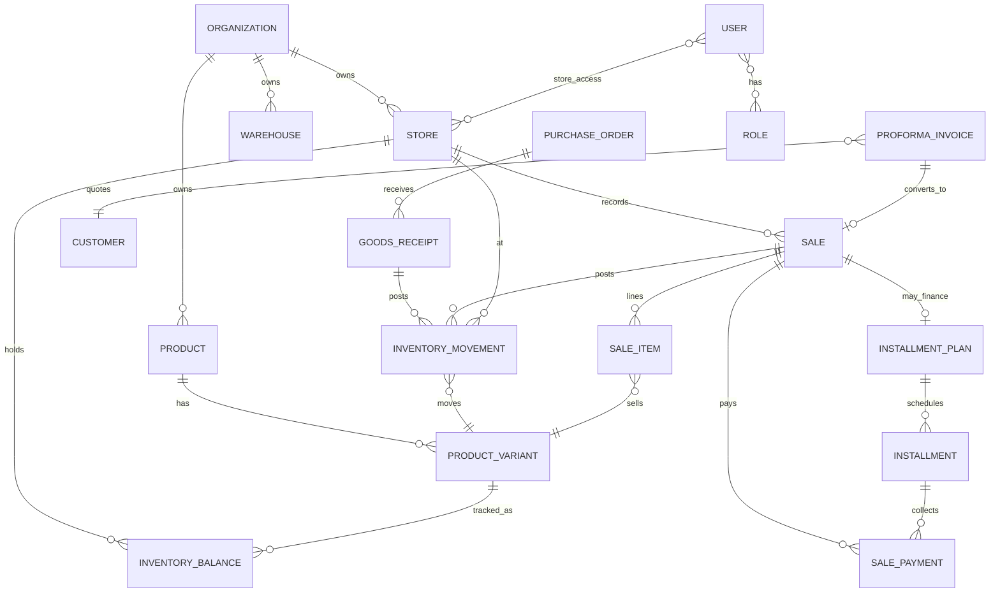

# Domain Model — retail-soln

**Status:** Epic 0.1 complete  
**Sources:** PRD, ARCHITECTURE-SPINE (AD-2, AD-3, AD-4)  
**Date:** 2026-08-24

## Bounded Contexts

| Context | Owns | Does not own |
| --- | --- | --- |
| **Organization** | Org, Store, Warehouse, Settings | Sales, Inventory balances |
| **Identity** | User, Employee, Role, Permission, StoreAccess | Business transactions |
| **Catalog** | Product, Variant, Category, Brand, Unit, Barcode | Stock quantities |
| **Inventory** | Movement, Balance, Transfer, Count, Reservation | Pricing rules |
| **Purchasing** | Supplier, PO, GRN, SupplierInvoice, SupplierPayment | Customer sales |
| **Sales** | Sale, SaleItem, SalePayment, Return, Refund, CashierSession, InstallmentPlan, Installment, ProformaInvoice | Supplier POs |
| **Pricing** | PriceList, Price, Promotion, Tax, LoyaltyRule | Stock |
| **Customers** | Customer, Address, Group, LoyaltyAccount | POS UI |
| **Payments** | PaymentIntent, Provider adapters (manual/Stripe/Paystack) | Inventory |
| **Accounting** | Journal, JournalLine, Account (double-entry) | Operational UI |
| **Sync** | Device, SyncBatch, SyncRecord, OversellException | Domain mutation rules (delegates) |
| **Audit** | AuditLog | Business write paths |

## Core Aggregates (MVP)

### Organization Aggregate
- `Organization` 1—* `Store`
- `Organization` 1—* `Warehouse`
- Store holds currency, tax profile, opening hours, delivery config

### Identity Aggregate
- `User` *—* `Role` (via permissions)
- `User` *—* `Store` (via `store_access`)
- `Employee` 1—1 `User` (optional link)

### Catalog Aggregate
- `Product` 1—* `ProductVariant`
- `ProductVariant` 1—* `Barcode`
- Product → Category, Brand, Unit, default Supplier

### Inventory Aggregate (AD-2)
- `InventoryBalance` per (store|warehouse, variant): available, reserved, damaged, in_transit
- `InventoryMovement` append-only: type, qty, cost, reference_type, reference_id, user_id, store_id
- `StockTransfer` + items; `StockCount` + lines → adjustment movements
- **Rule:** Balances never mutated except through movement posting service

### Purchasing Aggregate
- `Supplier` → contacts, product mappings
- `PurchaseOrder` → items → status machine (draft → pending_approval → approved → partial/received → closed)
- `GoodsReceipt` → items (partial OK) → posts purchase movements
- `SupplierInvoice` / `SupplierPayment`

### Sales Aggregate (AD-3, AD-14)
- `CashierSession` (terminal, opening float, variance on close)
- `Sale` (uuid, store, terminal, cashier, customer) → items → payments
- Atomic boundary: sale + items + movements + payments + invoice stub + audit
- `Return` / `Refund` reverse path
- `InstallmentPlan` (optional on sale/invoice) 1—* `Installment` (sequence, amount, due_at, status); collections link `payment_id`; outstanding = principal (+ fees) − paid; registered customer required; default mode `pay_over_time` (inventory at sale); optional `layaway`
- **Proforma Invoice (AD-15):** `ProformaInvoice` + items; separate number series; statuses draft|issued|accepted|converted|expired|cancelled; no ledger/AR until convert → Sale and/or Tax Invoice

### Pricing / Loyalty / Tax
- `PriceList` + `Price` (variant-scoped)
- `Promotion` + rules
- `TaxRate` / `TaxCategory` (store- and product-scoped)
- `LoyaltyProgram` + `LoyaltyRule` + `LoyaltyLedger` (AD-11)

### Payments (AD-10)
- `Payment` with provider enum: `manual` | `stripe` | `paystack`
- Webhook events stored with idempotency key

### Accounting (AD-12)
- Chart of accounts; `JournalEntry` + lines (debits = credits)
- Posted from sales, purchases, payments via accounting hooks (may lag MVP UI)

## Multi-Store Isolation Strategy

1. Every operational table carries `organization_id`
2. Store-scoped tables carry `store_id` (or `location_id` polymorphic for warehouse)
3. Eloquent global scopes + Policy checks (AD-4)
4. Cross-store reads only with explicit permission (e.g. org admin inventory overview)

## Relationship Diagram (conceptual)

## Open design notes for implementers

- Location abstraction: prefer `location_type` + `location_id` on balances/movements vs separate store/warehouse FKs — decide in Story 2.3
- Serial/batch/expiry: columns nullable on movement lines; full lot tracking deferred unless needed for MVP SKUs
