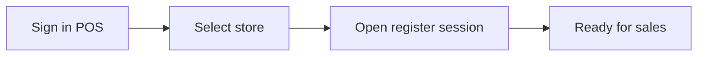
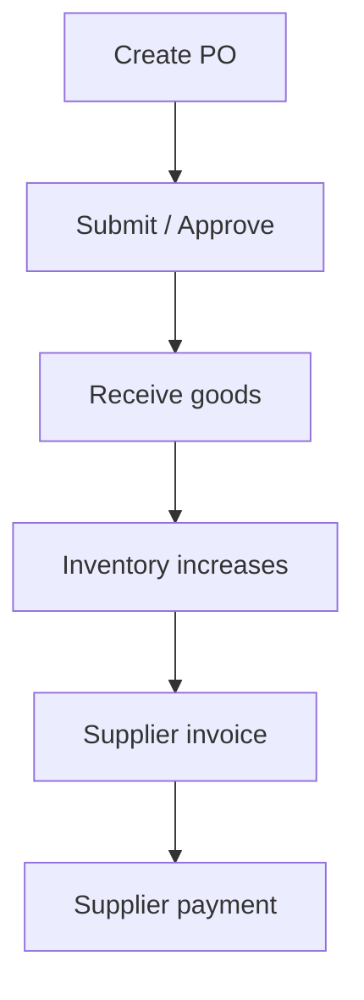

# retail-soln — Operational Manual

**Version:** Epics 1–4 (MVP online POS)  
**Last updated:** August 2026  
**Audience:** Store managers, cashiers, inventory staff, procurement, and organization administrators

This manual explains how to run and operate **retail-soln** end to end using the **Admin** web app and the **POS** point-of-sale app. It covers everything built through Epic 4: platform setup, catalog & inventory, purchasing, pricing, customers, online sales, cash sessions, returns, installments, and proforma invoices.

**Not covered here (future releases):** offline sync (Epic 5), customer portal (Epic 6), advanced reporting, Stripe/Paystack card capture in production, loyalty rules engine, and ESC/POS hardware drivers.

---

## Table of contents

1. [System overview](#1-system-overview)
2. [Getting the system running](#2-getting-the-system-running)
3. [Sign-in and roles](#3-sign-in-and-roles)
4. [Recommended first-time setup](#4-recommended-first-time-setup)
5. [Admin application guide](#5-admin-application-guide) — includes [Products & variants](#products--variants)
6. [Pricing, cost, and discounts](#6-pricing-cost-and-discounts)
7. [POS application guide](#7-pos-application-guide)
8. [End-to-end operational workflows](#8-end-to-end-operational-workflows)
9. [Keyboard shortcuts (POS)](#9-keyboard-shortcuts-pos)
10. [Troubleshooting](#10-troubleshooting)
11. [Current limitations](#11-current-limitations)

---

## 1. System overview

retail-soln is a multi-store retail platform with two browser applications:

| Application | URL (local dev) | Who uses it |
|-------------|-----------------|-------------|
| **Admin** | http://localhost:5173 | Managers, inventory, procurement, accountants |
| **POS** | http://localhost:5174 | Cashiers and floor staff |
| **API** | http://localhost:8001 or http://localhost:8080 | Used automatically by the apps (not opened directly) |

Both apps talk to the same backend API (`/api/v1`). Users sign in once per app; the POS also requires **selecting a store** after login.

### Core concepts

- **Organization** — One business tenant per deployment (name, currency, timezone).
- **Store** — A retail location. Stock, sales, sessions, and many reports are **store-scoped**.
- **Product / variant** — Catalog parent (product) and sellable child (variant). See [§5 Products & variants](#products--variants).
- **Inventory ledger** — Stock changes only through documented movements (receipts, sales, adjustments, transfers). You cannot edit stock arbitrarily without an adjustment.
- **Cashier session** — A register shift. **Payment is blocked until a session is open.**
- **Walk-in customer** — Default anonymous buyer. **Registered customers** are required for installment plans and proforma invoices.
- **Proforma invoice** — A **quote** (non-fiscal). It does **not** move stock or create debt until **converted** to a sale or tax invoice.
- **Installment plan** — Accounts-receivable schedule linked to a sale; deposits and later collections update customer balance.

---

## 2. Getting the system running

### Option A — Docker (recommended for a full stack)

From the repository root:

```bash
docker compose up -d --build
```

Services:

| Service | Purpose |
|---------|---------|
| `mysql` | Database |
| `redis` | Cache / queues |
| `app` | Laravel API |
| `nginx` | API gateway at **http://localhost:8080** |
| `queue` | Background jobs (receipts, proforma email stub) |

Verify the API:

```bash
curl -sf http://localhost:8080/api/v1/health
```

### Option B — Local development (Herd / PHP)

```bash
cd backend
composer install
cp -n .env.example .env    # if needed
php artisan key:generate
php artisan migrate
php artisan db:seed
php artisan serve --port=8001
```

Use port **8001** if **8000** is already taken (common with Laravel Herd).

### Frontends

```bash
# Admin
cd frontend/admin && npm install && cp -n .env.example .env && npm run dev
# → http://localhost:5173

# POS (separate terminal)
cd frontend/pos && npm install && cp -n .env.example .env && npm run dev
# → http://localhost:5174
```

Ensure each app’s `.env` **`VITE_PROXY_TARGET`** points at your API:

- Local `artisan serve` on 8001 → `http://localhost:8001`
- Docker nginx → `http://localhost:8080`

### Database seed (development)

After migrations, seed permissions and demo users:

```bash
cd backend && php artisan db:seed
```

This creates RBAC permissions, a default organization (on first API use), walk-in customer, default price list, and development logins (see below).

---

## 3. Sign-in and roles

### Development accounts (after `db:seed`)

| Email | Password | Typical use |
|-------|----------|-------------|
| `admin@retail.local` | `password` | Full org admin — all modules |
| `inventory@retail.local` | `password` | Products, inventory, receiving |
| `procurement@retail.local` | `password` | Suppliers, purchase orders, supplier payments |

**Change these passwords before any shared or production environment.**

### Role summary

| Role | Admin highlights | POS highlights |
|------|------------------|----------------|
| **Org Admin (OA)** | Everything including org settings, users, pricing | Full POS if assigned to stores |
| **Store Manager (SM)** | Store ops, proformas, approve POs, void/refund | Sessions, sales, installments, returns |
| **Cashier (CA)** | Limited admin | Sales, collect installments, returns (if permitted) |
| **Inventory Manager (IM)** | Products, stock, receive goods | View stock-related data |
| **Procurement Officer (PO)** | Suppliers, POs, pay suppliers | — |
| **Accountant (AC)** | Payments, invoices, audit, reconcile | View sales / collect installments |

Permissions are **store-scoped** where marked: a user only sees data for stores they are assigned to.

### Assigning users to stores

1. Admin → **Users**
2. Create or edit a user and assign **store access**
3. Cashiers **must** have at least one store to use POS

---

## 4. Recommended first-time setup

Complete these steps in order before going live on the floor.

### Step 1 — Organization & stores

1. **Admin → Organization** — Set legal name, default currency, timezone.
2. **Admin → Stores** — Create each retail location.
   - Set **tax config** (rate, inclusive/exclusive, tax name). This drives POS tax calculation.
   - Set address and currency per store if needed.

### Step 2 — Users & access

1. **Admin → Users** — Create cashier and manager accounts.
2. Assign each user to the correct **store(s)**.

### Step 3 — Product catalog

1. **Admin → Products** — Create products and categories/brands as needed (a **default variant** is created automatically).
2. For multi-SKU items, add more **variants** with unique SKU, barcode, and **selling price** (see [Products & variants](#products--variants)).
3. Optional: **Import** products via CSV (Products page).

### Step 4 — Opening stock

1. **Admin → Inventory** — Post an **adjustment** to set opening quantities per store, **or**
2. Receive stock through **Purchase orders** (see [Procurement workflow](#procurement-receive-stock-and-pay-suppliers)).

### Step 5 — Pricing (optional)

1. **Admin → Pricing** — Create **price lists** and store-specific prices.
2. Create **promotions** (percentage/amount off) when needed.
3. If no price list exists, the variant’s selling price is used.

See [§6 Pricing, cost, and discounts](#6-pricing-cost-and-discounts) for how cost, selling price, and discounts relate.

### Step 6 — Customers

1. **Admin → Customers** — Register business/corporate customers for credit, installments, and proformas.
2. Walk-in is created automatically; no setup required.

### Step 7 — POS smoke test

1. Open POS → select store → **open register session**.
2. Scan/search a product → **Pay** → confirm receipt.
3. Check **Admin → Inventory** — quantity should decrease.

---

## 5. Admin application guide

Navigation is in the left sidebar. All pages require sign-in.

### Dashboard

Landing page after login. Use sidebar links for day-to-day work.

### Organization

View and edit organization profile (name, legal name, currency, timezone). Org admins only for updates.

### Stores

- Create and edit stores
- Configure **tax** (`tax_config`: rate, inclusive flag, label)
- Set address and currency

### Products

- CRUD products, categories, brands, units (quick-create on Products page)
- **Variants**: SKU, barcode, selling price, cost, active flag
- **Import / export** CSV for bulk catalog work
- Search by SKU, barcode, name

See **[Products & variants](#products--variants)** below for how the parent product relates to sellable SKUs.

### Products & variants

The catalog uses a **parent / child** model. You never sell a “product” directly at the till — **sales, stock, purchase orders, and price lists all work on variants** (individual SKUs). The product is the shared grouping and catalog metadata.

| Layer | What it is | Example |
|-------|------------|---------|
| **Product** | Shared catalog item — name, category, brand, supplier, stock thresholds | “T‑Shirt” |
| **Variant** | Sellable SKU under that product — size, colour, or any distinct item you stock and scan | “T‑Shirt — Red / Large” |

#### What belongs on the product

- Display **name**, **description**, image URL
- **Category**, **brand**, **unit**, default **supplier**
- **Selling price** and **cost price** (defaults used when creating variants)
- **Reorder / min / max** stock levels (product-level planning fields)
- Product-level **SKU** and **barcode** (seed values for the default variant)

#### What belongs on the variant

- Its own **name** (e.g. “Red / L”, or “Default” for single-SKU items)
- Its own **SKU** — must be **unique across the organization**
- Its own **selling price** and **cost**
- **Barcodes** (barcodes attach to variants, not products)
- **Active** flag and **default variant** flag

#### How they connect when you create a product

When you save a **new product**, the system automatically creates a **default variant**:

1. Variant name: `Default`
2. Variant SKU, selling price, and cost: copied from the product
3. Product barcode (if set): copied to the variant’s primary barcode

So even a simple one-SKU item has **two records** — a product (catalog info) and a variant (what POS and inventory use).

In **Admin → Products**, **Edit** opens:

1. The **product form** — shared details and default selling price
2. The **variants** panel — list of SKUs; use **Add variant** for additional sizes, colours, etc.

The product list shows a **variant count** per row. POS search matches **variant** SKU or barcode.

#### Examples

**Multi-variant product:**

```
Product: "Running Shoe"
├── Variant: "Size 8"   SKU: SHOE-8   barcode: 111…
├── Variant: "Size 9"   SKU: SHOE-9   barcode: 222…
└── Variant: "Size 10"  SKU: SHOE-10  barcode: 333…
```

**Single-SKU product:**

```
Product: "Bottled Water"
└── Variant: "Default"  SKU: WATER-001  (created automatically)
```

#### Rules to remember

1. **SKU uniqueness** is enforced on **variants**, not on products.
2. **Stock** is tracked per **variant** per store (see Inventory).
3. **Price lists** and **POS** resolve price on the **variant**; the product selling price is mainly a default when variants are created.
4. Editing the product **selling price** does **not** automatically update existing variant prices — only the default variant receives those values at creation time.
5. CSV **import** creates products and provisions a default variant per row (`sellingPrice` column).

### Inventory

- **Balances** — On-hand and available quantity per store
- **Adjustments** — Increase/decrease stock with reason (manager/inventory permission)
- **Transfers** — Move stock between stores; **receive** at destination
- **Stock counts** — Cycle count workflow
- **Low-stock alerts** — Variants below threshold

### Suppliers

- Supplier master data, contacts, addresses
- **Product mappings** — Link supplier SKUs to your variants and costs
- Export supplier list

### Purchase orders

Full procurement cycle:

| Status | Meaning | Actions |
|--------|---------|---------|
| Draft / Rejected | Editable | Submit for approval |
| Pending approval | Awaiting manager | Approve or reject |
| Approved | Ready to receive | **Receive goods** |
| Partial / Received | Stock in transit or done | Receive more, **return** to supplier |
| Closed | Complete | — |

- Create PO: pick store, supplier, lines (variant, qty, unit cost)
- **Receive** — Posts inventory via goods receipt (partial receipts supported)
- **Purchase returns** — Return stock against a receipt
- **Supplier invoices & payments** — Admin → **Payments** (supplier AP)

### Payments (supplier)

Record supplier invoices and payments against purchase activity. Used by procurement and accounting roles.

### Pricing

- **Price lists** — Org-wide or store-scoped; assign prices per variant
- **Promotions** — Rules applied at POS price resolution
- Default org price list is seeded as “Retail”

For a full explanation of **cost vs selling price** and **where discounts are set**, see [§6 Pricing, cost, and discounts](#6-pricing-cost-and-discounts).

### Customers

- Create **registered**, **business**, or **corporate** customers
- Credit limit and running **balance** (installments increase balance; collections decrease it)
- **Customer groups** for segmentation
- **History** — Recent sales, installment plans, returns (select a customer in the list)

### Proforma invoices

Non-fiscal **quotes** for registered customers only.

| Status | Meaning |
|--------|---------|
| Draft | Editable, no document number |
| Issued | Number assigned (`PF-{store}-{seq}`), PDF available |
| Accepted | Customer accepted (optional workflow) |
| Converted | Linked to resulting sale and/or tax invoice |
| Expired | Past `valid_until` date |
| Cancelled | Voided quote |

**Actions:**

1. **New proforma** — Store, customer, line items, optional validity date
2. **Issue** — Assigns proforma number; queues delivery log (email integration is stubbed)
3. **Download** — HTML document labeled **“Proforma — Not a tax invoice”**
4. **Convert** — Creates a real sale (stock + payment) and/or tax invoice
   - Requires an **open cashier session ID** and payment amount for sale conversion
   - Check **Honor proforma prices** to keep quoted prices (managers with permission); otherwise current price list applies
5. **Cancel** — Void before conversion

### Users

Create users, assign **role**, and **store access**. Required before staff can use POS.

### Audit logs

Read-only trail of create/update/delete on auditable records. Filter by store where applicable. Accountants and managers.

### Settings

Organization-level key/value settings (receipt footer, discount caps, etc.). Org admin.

---

## 6. Pricing, cost, and discounts

This section explains the difference between **what you paid** for a product and **what you charge** the customer, and where each type of discount is configured.

### Cost vs selling price — quick reference

| Field | Where to set it | Used at checkout? | Purpose |
|-------|-----------------|-------------------|---------|
| **Cost price** | Admin → **Products** → **Cost price** (product) or **Cost** (variant) | No | Internal reference — margin, reporting, catalog. Optional. |
| **Selling price** | Admin → **Products** → **Selling price** (product) or variant **Selling price** | Yes (fallback) | What you charge customers. Product-level price seeds the default variant; variant price is used at POS when no price list overrides it. |
| **Price list amount** | Admin → **Pricing** → price lists | Yes (preferred) | Store- or org-specific selling price. **Takes priority** over variant selling price at POS. |
| **PO unit cost** | Admin → **Purchase orders** → line **Unit cost** | No | Cost on a specific purchase/receipt. Does **not** auto-update catalog cost price. |
| **Supplier mapping cost** | Admin → **Suppliers** → product mapping **Cost** | No | Reference cost from that supplier when creating POs. |

**Rule of thumb:** **Cost price** = what it cost you. **Selling price** = what the customer pays (from price list or variant price, minus promotions).

### How the POS picks the selling price

When a product is scanned or added to the cart, the system resolves the unit price in this order:

```
1. Store-specific price list  (if one exists for the current store)
        ↓ if not found
2. Organization default price list
        ↓ if not found
3. Variant selling price      (from Products → variant Selling price)
```

Promotions (see below) are applied **after** the list price is found. Tax is calculated on the net amount after discount, using the store’s **tax config** (Admin → Stores).

You can preview the resolved price in **Admin → Pricing** using the **Resolve** tool (store + variant + quantity).

### Setting selling prices (recommended workflow)

1. **Simple single-store setup** — Set **Selling price** on each product (and per variant if needed). No price list required.
2. **Multi-store or channel pricing** — Create price lists in **Admin → Pricing**:
   - **Org default** list — applies everywhere unless a store list exists
   - **Store-scoped** list — overrides org default for that store only
3. Add or update **prices** on each list (variant + amount).

After changing prices, POS carts already open may need a quantity bump or re-add to refresh resolved totals.

### Setting cost

| Method | When to use |
|--------|-------------|
| **Products → Cost price** | Set a standard cost when creating/editing the catalog |
| **Variant → Cost** | Different cost per size/colour/SKU |
| **CSV import** | Bulk load `costPrice` column with products |
| **Purchase order unit cost** | Record what you actually paid on each buy; used for supplier AP, not POS |

Catalog **cost price** and PO **unit cost** are separate fields today — receiving goods does not automatically rewrite the product’s cost price.

### Where discounts are set

There are four distinct discount mechanisms:

#### 1. Promotions (automatic) — Admin → Pricing → Promotions

Configured by users with `promotions.manage` permission. Applied automatically when items are priced at POS (and when proformas are converted without honoring quoted prices).

| Rule type | Example |
|-----------|---------|
| **Percent** | 10% off a variant or category |
| **Fixed amount** | ₦500 off |
| **BOGO** | Buy 2, get 1 at X% off |

Set **store scope** (all stores or one store), **start/end dates**, and **active** flag. The best matching promotion for the line is applied; the cart shows `disc …` on the line when a promo discount is present.

#### 2. Price override (manual at POS) — cart line **Override price**

For ad-hoc discounts or price changes at the register:

1. Add item to cart
2. Click **Override price** on the line (visible only with `sales.price-override` permission — typically Store Manager and above, **not** cashiers)
3. Enter the new unit price

Lowering the price acts like a manual discount. **Promotions are cleared** on overridden lines (the override becomes the unit price). Click **Clear override** to restore list/variant pricing and promotions.

> **Note:** The **F8 Discount** panel is not yet implemented. Use promotions for planned discounts and price override for one-off adjustments.

#### 3. Proforma line discount — Admin → Proforma invoices

When creating or editing a **draft** proforma, each line has a **Discount** field for a fixed per-line discount amount before issue. Totals on the proforma PDF include `discount_total`.

On **Convert**, check **Honor proforma prices** (requires `invoices.proforma.honor-prices`) to keep quoted unit prices and line discounts; otherwise current price lists and promotions are re-applied.

#### 4. Discount caps (future / settings)

Permission `sales.discount` exists for cashiers and managers. Store-level discount caps via **Admin → Settings** are planned; line-level POS discount UI (F8) is not built yet.

### Permissions summary

| Permission | Who (typical) | Effect |
|------------|---------------|--------|
| `pricing.manage` | Org admin, store manager | Create price lists and set list prices |
| `promotions.manage` | Org admin, store manager | Create and edit promotions |
| `sales.price-override` | Org admin, store manager | Override unit price on POS cart lines |
| `sales.discount` | Cashier+ | Reserved for future F8 line-discount UI |
| `invoices.proforma.honor-prices` | Org admin, store manager | Convert proforma keeping quoted prices/discounts |

### Examples

**Example A — Standard retail**

- Variant price: ₦1,000  
- No price list, no promotion  
- **Customer pays:** ₦1,000 (+ tax per store config)

**Example B — Store price list**

- Variant price: ₦1,000  
- Store price list: ₦950 for that variant  
- **Customer pays:** ₦950 (+ tax)

**Example C — Promotion**

- List price: ₦1,000  
- Active promotion: 10% off  
- **Customer pays:** ₦900 (+ tax); line shows `disc 100.00`

**Example D — Manager override**

- List price: ₦1,000  
- Manager overrides to ₦850  
- **Customer pays:** ₦850 (+ tax); promotion not applied on that line

**Example E — Margin check (internal)**

- Cost price on variant: ₦600  
- Selling price (resolved): ₦1,000  
- **Gross margin:** ₦400 per unit (before tax; cost is not shown to cashiers at POS)

---

## 7. POS application guide

### Login and store selection

1. Open **http://localhost:5174**
2. Sign in with a user that has **store access**
3. **Select a store** on the picker screen
4. You arrive at the **POS floor** (search + cart)

Use **Change store** in the header to switch locations (clears the current cart context).

### Header indicators

| Indicator | Meaning |
|-----------|---------|
| **Session: Open / Closed** | Green = register session open; red = must open before payment |
| **ONLINE** | Connected to API (offline mode is Epic 5) |
| **Installment / Return** | Buttons appear when your role has permission |

### Register session (required for sales)

1. Click **Session: Closed** (or use payment flow — you’ll be prompted)
2. **Open session** — Enter opening float (cash in drawer)
3. During shift: record **cash in / cash out** movements
4. **Close session** — Count closing cash; system shows expected vs actual

Each cashier should use their **own** open session for sales and installment collections.

### Building a sale

1. **Search** — Type SKU, barcode, or product name; press **Enter** to add the first match
2. **Categories** — Filter the product grid
3. **Cart** — Adjust quantity (+/−); remove lines
4. **Price override** — Managers with permission can override unit price on a line
5. **Customer (F4)** — Attach a registered customer (needed for installments)
6. **Pay (F9)** — Open payment panel when session is open

### Payment panel

- Enter **cash** and/or **card** amounts (manual tender — card is recorded, not gateway-processed yet)
- Payment total must **equal sale total** (2 decimal places)
- **Installment plan** (managers only, registered customer):
  - Deposit must be **less than** sale total
  - Schedule installments that sum to the **remaining balance**
  - Customer **credit limit** is enforced
- On success: receipt summary shown; print job queued

### Hold, resume, void

| Action | When to use |
|--------|-------------|
| **Hold** | Customer steps away; cart saved as held sale |
| **Held** (panel) | List and **resume** a held sale into the cart |
| **Void** | Cancel current held sale or clear an in-progress cart |

Voiding a **completed** sale from POS is not exposed in the UI; managers use **returns** or admin/API void with `sales.void` permission.

### Returns & refunds

1. Click **Return** in the header
2. Enter **sale ID** from the original receipt
3. Select lines and quantities to return
4. Refund posts stock back and records refund tender

Requires `sales.refund` permission (typically managers).

### Installment collection

1. Click **Installment** in the header
2. Search open plans (overdue filter available)
3. Select installment and amount (full amount required unless partial permission)
4. Payment records cash movement and reduces customer balance

Cashiers can collect; creating plans at sale time requires manager permission.

### Discount (F8)

The discount panel is a **placeholder**. See [§6 Pricing, cost, and discounts](#6-pricing-cost-and-discounts) for how discounts work today:

- **Promotions** (Admin → Pricing) apply automatically at checkout
- **Price override** on cart lines (managers with `sales.price-override`) for one-off reductions
- **Proforma line discounts** when quoting in Admin

Line-level manual discount UI (F8) is not yet available.

---

## 8. End-to-end operational workflows

### Daily store open (cashier)



1. Sign in → select store  
2. Open session with opening float  
3. Verify search finds products and stock is available  

### Standard sale

1. Open session (if not already open)  
2. Scan/search items into cart  
3. Optional: attach customer (F4)  
4. Pay (F9) — cash/card for full amount  
5. Give receipt summary to customer  

**Result:** Stock decreases, sale completed, tax invoice created, receipt queued.

### Sale with installment plan (manager)

1. Attach **registered** customer (not walk-in)  
2. Add items to cart  
3. Pay (F9) — enter **deposit** (cash/card)  
4. Enable **installment plan** — set number of installments and due dates  
5. Complete — verify installments sum to balance after deposit  

**Result:** Sale completed; plan open; customer balance increased by financed principal.

### Collect later installment payment

1. Customer returns to pay installment  
2. POS → **Installment** → find plan  
3. Collect due amount (same or next open session)  

### Hold and resume

1. Build cart → **Hold**  
2. Later: **Held** panel → tap sale → cart restored with customer if present  
3. Complete payment normally  

### Return after sale

1. POS → **Return** → enter sale ID  
2. Select items/qty → confirm refund  
3. Stock returns to store inventory  

### Procurement: receive stock and pay suppliers



1. **Admin → Purchase orders** — Create PO for supplier  
2. Manager **approves**  
3. **Receive** — Enter quantities received (partial OK)  
4. **Admin → Payments** — Record supplier invoice and payment  

### Proforma quote to sale (manager)

1. **Admin → Proforma invoices** — New draft for customer + lines  
2. **Issue** — Send/download PDF quote  
3. When customer confirms: **Convert**
   - Target: **Sale** (stock + payment) or **Tax invoice only** (no stock)  
   - For sale: provide session ID and payment  
4. Proforma status becomes **Converted** with links to sale/invoice  

### Inventory adjustment (stock correction)

1. **Admin → Inventory**  
2. New adjustment — variant, signed quantity (+/-), store  
3. Confirm — ledger posts movement  

### Stock transfer between stores

1. **Admin → Inventory → Transfers** — Create transfer from Store A  
2. At Store B — **Receive transfer**  
3. Stock leaves A and enters B  

---

## 9. Keyboard shortcuts (POS)

| Key | Action |
|-----|--------|
| **F2** | Focus product search |
| **F4** | Customer lookup panel |
| **F8** | Discount panel (placeholder) |
| **F9** | Payment panel (or session if closed) |
| **Esc** | Close open panel / cancel price override |
| **Enter** | In search — add first search result to cart |

Footer reminder on POS floor: `F2 search · F4 customer · F8 discount · F9 pay · Esc cancel`

---

## 10. Troubleshooting

### Login fails or “Request failed (502)”

- Confirm API is running: `curl http://localhost:8080/api/v1/health` or `:8001`
- Check `VITE_PROXY_TARGET` in `frontend/admin/.env` or `frontend/pos/.env` matches API port
- Restart the Vite dev server after changing `.env`
- Kill stale POS dev server: `lsof -ti :5174 | xargs kill` then `npm run dev` again

### POS: “Open a register session before taking payment”

- Click **Session: Closed** → **Open session** with opening float  
- Only one open session per cashier/terminal pattern applies — use your own session

### “Payment total must equal sale total”

- Ensure cash + card amounts sum **exactly** to the cart total (2 dp)  
- For installments, deposit + schedule must match total  

### “Insufficient available stock for sale”

- Check **Admin → Inventory** balances for that store  
- Receive PO or post adjustment to add stock  

### “Installment plans require a registered customer”

- Press **F4** and select a non-walk-in customer before paying with installments  

### Proforma convert fails on session

- An **open cashier session** at the proforma’s store is required for sale conversion  
- Open POS at that store first, or use **Tax invoice only** target if no stock movement is needed  

### User cannot see a store in POS

- **Admin → Users** — assign store access to that user  

### Migrations / empty database

```bash
cd backend
php artisan migrate
php artisan db:seed
```

---

## 11. Current limitations

Features **not yet available** in Epics 1–4 (planned or deferred):

| Feature | Status |
|---------|--------|
| Offline POS / sync | Epic 5 |
| Stripe / Paystack live card capture | Manual tender only at POS |
| F8 line discount UI | Stub; use promotions or price override |
| Void completed sale from POS UI | Use returns; API void exists for managers |
| Warehouse admin UI | API only |
| Cashier session reconciliation screen | API only (`registers.reconcile`) |
| Loyalty points/rules | AD-11 deferred |
| Customer portal / online orders | Epic 6 |
| ESC/POS receipt printer driver | Receipt print job queued; hardware adapter pending |
| Gift cards | Deferred |

---

## Quick reference — Admin navigation

| Menu | Primary tasks |
|------|----------------|
| Organization | Business profile |
| Stores | Locations, tax config |
| Products | Catalog, variants, selling price & cost, import — see [Products & variants](#products--variants) |
| Suppliers | Vendor master data |
| Purchase orders | Buy stock, receive, return |
| Payments | Pay suppliers |
| Inventory | Stock, adjustments, transfers |
| Pricing | Lists, promotions, price resolve preview (see [§6](#6-pricing-cost-and-discounts)) |
| Customers | Accounts, credit, history |
| Proforma invoices | Quotes, issue, convert |
| Users | Staff accounts, store access |
| Audit logs | Compliance trail |
| Settings | Org configuration |

## Quick reference — POS actions

| UI | Task |
|----|------|
| Search bar | Add products |
| Customer F4 | Attach account |
| Session | Open / close register |
| Hold / Held | Suspend and resume sales |
| Pay F9 | Checkout |
| Installment | Collect AR payment |
| Return | Refund completed sale |
| Change store | Switch location |

---

*For technical architecture, API contracts, and development setup, see `AGENTS.md` and `_bmad-output/planning-artifacts/` in the repository.*
